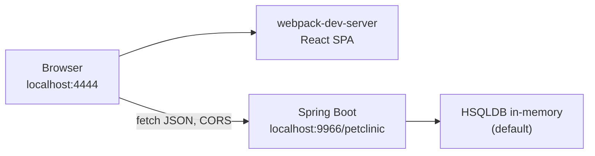
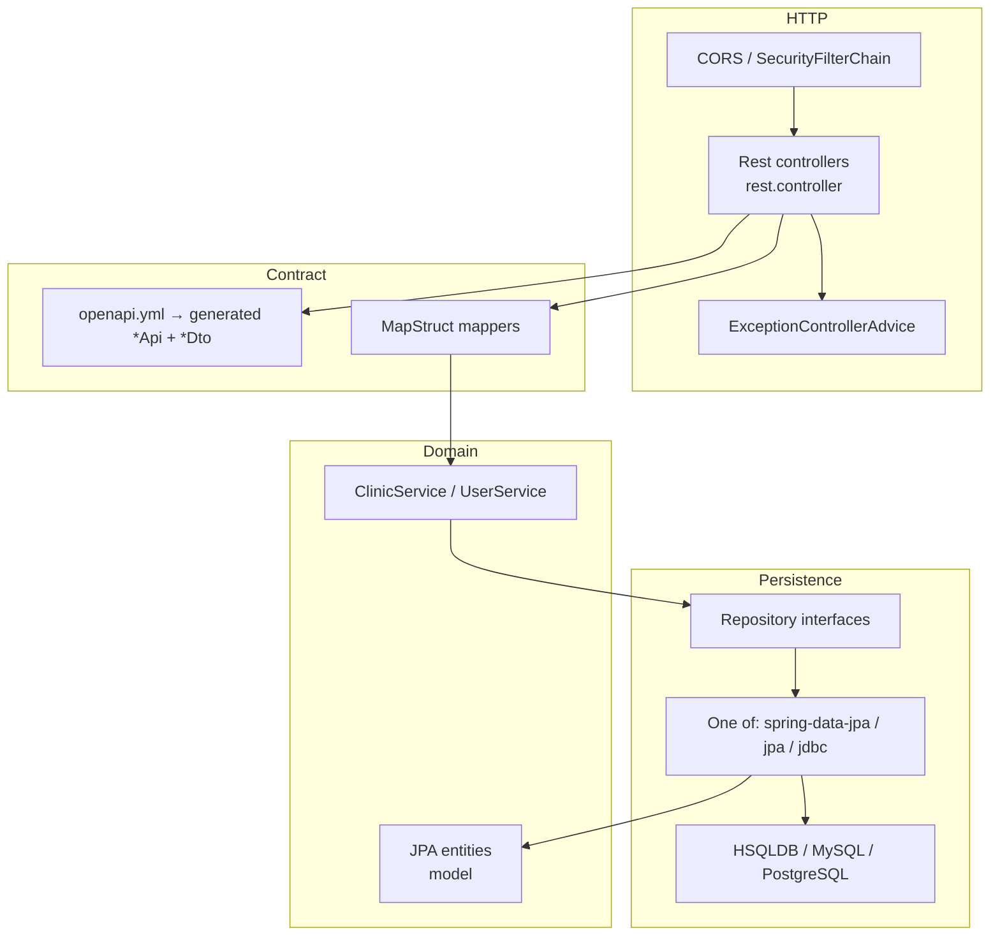

# Architecture of Spring PetClinic ReactJS

**Date:** 5 November 2026
**Scope:** the application as it runs after the frontend modernization (`chore/upgrade-frontend`). Backend sources were not changed in that work.

This is a review of the running system: what each layer does, how a request travels through it, and where the layers currently disagree with each other.

---

## 1. What this application is

Spring PetClinic is a sample clinic desk: clerks look up owners and their pets, record visits, and list veterinarians. This repository is a **two-process** split of that sample:

| Process | Stack | Default URL | Role |
|---|---|---|---|
| Backend | Spring Boot 3.2.1, Java, Maven (`artifactId`: `spring-petclinic-rest`) | `http://localhost:9966/petclinic` | REST API, JPA, security, OpenAPI |
| Frontend | React 19 + TypeScript 6, webpack-dev-server | `http://localhost:4444` | Single-page UI that calls the API with `fetch` |

The UI is not served by Spring. webpack-dev-server serves `client/public/index.html` and the compiled bundle; the browser then calls the API on port 9966. CORS on the backend allows origin `http://localhost:4444`.

That split is deliberate. The original README notes that a JavaScript SPA and a REST backend are commonly run as two servers. There is no shared session and no server-side rendering.



Start the backend first (`./mvnw spring-boot:run`), then the client (`PORT=4444 npm start` from `client/`). Stopping the Maven process with Ctrl+C shuts the API down; the UI will still load but every `fetch` will fail.

---

## 2. Backend layers

Java packages live under `src/main/java/org/springframework/samples/petclinic`. A request that hits the API walks these layers from the outside in:



### 2.1 Boot and configuration

`PetClinicApplication` is a standard `@SpringBootApplication`. Runtime knobs are in `src/main/resources/application.properties`:

| Property | Default | Meaning |
|---|---|---|
| `spring.profiles.active` | `hsqldb,spring-data-jpa` | Which database script to run, and which repository implementation to load |
| `server.port` | `9966` | HTTP port |
| `server.servlet.context-path` | `/petclinic/` | Every URL is prefixed with this |
| `petclinic.security.enable` | `false` | When false, every request is permitted |

A second properties file is chosen by the database profile, for example `application-hsqldb.properties`: in-memory JDBC URL, and SQL scripts `db/hsqldb/initDB.sql` + `populateDB.sql`. Hibernate `ddl-auto` is `none`; the schema comes from those scripts, not from entity scanning.

Swagger UI is at `/petclinic/swagger-ui/index.html`. `GET /petclinic/` redirects there (`RootRestController`).

### 2.2 Domain model

Entities are JPA classes in `model/`, with a small inheritance tree:

```
BaseEntity          id, isNew()
  └── Person        firstName, lastName
        ├── Owner   address, city, telephone, pets
        └── Vet     specialties
  └── NamedEntity   name
        ├── Pet     birthDate, type, owner, visits
        ├── PetType
        └── Specialty
Visit               date, description, pet
User                username, password, enabled, roles
Role                username + role name
```

`Owner` maps to table `owners` and owns `Pet`s (`@OneToMany`, EAGER). `Pet` has a `PetType` and a list of `Visit`s. `Vet` is linked to `Specialty` through the join table `vet_specialties`. Bean Validation annotations (`@NotEmpty`, `@Digits`) sit on the entities and are also generated onto the OpenAPI DTOs.

`User` / `Role` are not part of the clinic desk UI. They exist so JDBC authentication has tables to read when security is turned on.

### 2.3 Database

Default store is **HSQLDB in memory** (`jdbc:hsqldb:mem:petclinic`). The process starts empty, runs `initDB.sql`, then `populateDB.sql`, and loses the data when it stops.

Schema (from `src/main/resources/db/hsqldb/initDB.sql`):

| Table | Purpose |
|---|---|
| `owners` | Pet owners (name, address, city, telephone) |
| `pets` | Pets; FK to `owners` and `types` |
| `types` | Pet types (cat, dog, …) |
| `visits` | Clinic visits; FK to `pets` |
| `vets` | Veterinarians |
| `specialties` | Vet specialties |
| `vet_specialties` | Vet ↔ specialty many-to-many |
| `users` | Login names (security) |
| `roles` | Authorities per user (security) |

Seed data includes 10 owners, 13 pets, 6 vets, 6 pet types, a handful of visits, and one user `admin` / `{noop}admin` with roles `ROLE_OWNER_ADMIN`, `ROLE_VET_ADMIN`, and `ROLE_ADMIN`. `{noop}` tells Spring Security the password is stored in plain text.

The same schema exists for **MySQL** and **PostgreSQL** under `src/main/resources/db/`. Switch with:

```
spring.profiles.active=mysql,spring-data-jpa
```

or `postgresql` in place of `mysql`. Those profiles are for running against a real database; local discovery uses HSQLDB.

### 2.4 Data access layer

The service layer depends only on interfaces in `repository/` (`OwnerRepository`, `PetRepository`, `VisitRepository`, `VetRepository`, `PetTypeRepository`, `SpecialtyRepository`, `UserRepository`). Three implementations of those interfaces are in the tree. Spring loads **exactly one** set, based on a profile:

| Profile | Package | Style |
|---|---|---|
| `spring-data-jpa` (default) | `repository.springdatajpa` | Spring Data interfaces. Query methods plus `@Query` JPQL where a join-fetch is needed (owners are loaded with their pets). Delete methods that JPA cannot derive sit on `*Override` + `*Impl` classes. |
| `jpa` | `repository.jpa` | Hand-written `EntityManager` code. Teaching sample for classic JPA. |
| `jdbc` | `repository.jdbc` | `JdbcTemplate` + `RowMapper`s. Teaching sample for SQL without an ORM. |

`ClinicServiceImpl` does not know which of the three is active. That is the point of the facade: controllers never touch a repository.

The default `spring-data-jpa` owner lookup is typical of this layer:

```38:43:src/main/java/org/springframework/samples/petclinic/repository/springdatajpa/SpringDataOwnerRepository.java
    @Query("SELECT DISTINCT owner FROM Owner owner left join fetch owner.pets WHERE owner.lastName LIKE :lastName%")
    Collection<Owner> findByLastName(@Param("lastName") String lastName);

    @Override
    @Query("SELECT owner FROM Owner owner left join fetch owner.pets WHERE owner.id =:id")
    Owner findById(@Param("id") int id);
```

Prefix match on last name, pets eagerly fetched to avoid lazy-load problems once the transaction closes (`spring.jpa.open-in-view=false`).

### 2.5 Service layer

`ClinicService` / `ClinicServiceImpl` is the single business facade for clinic data. Every REST controller that deals with owners, pets, visits, vets, types, or specialties calls it. Methods are `@Transactional`; read methods are `readOnly = true`.

`UserService` / `UserServiceImpl` only saves users (used by `UserRestController`). It is not used by the React UI.

There is almost no extra domain logic here: find, save, delete, plus a couple of lookups by name. Validation is on the entities/DTOs; HTTP mapping is in the controllers.

`CallMonitoringAspect` can time repository calls over JMX. Its own comment says it does not join on Spring Data JPA classes, so it is idle on the default profile.

---

## 3. API services

The HTTP API is **contract-first**.

1. `src/main/resources/openapi.yml` is the source of truth (OpenAPI 3, server URL `http://localhost:9966/petclinic/api`).
2. The `openapi-generator-maven-plugin` generates:
   - interfaces in `org.springframework.samples.petclinic.rest.api` (`OwnersApi`, `PetsApi`, …)
   - DTO classes in `org.springframework.samples.petclinic.rest.dto` (`OwnerDto`, `OwnerFieldsDto`, …)
3. Hand-written controllers in `rest.controller` **implement** those interfaces. They do not declare their own `@GetMapping` paths; the generated interface does.
4. MapStruct mappers in `mapper/` convert DTO ↔ entity (`OwnerMapper`, `PetMapper`, `VisitMapper`, `VetMapper`, `PetTypeMapper`, `SpecialtyMapper`, `UserMapper`).

Base path is `/petclinic/api/…`. Resources:

| Resource | Paths | Notes |
|---|---|---|
| Owners | `GET/POST /owners`, `GET/PUT/DELETE /owners/{ownerId}` | `GET /owners?lastName=` lists; empty last name returns all. No match → **404** with an empty body (not `[]`). |
| Owner's pets | `POST /owners/{ownerId}/pets`, `GET/PUT /owners/{ownerId}/pets/{petId}` | Create body is `PetFields`: `name`, `birthDate` (`yyyy-MM-dd`), `type` (object, not a type id). Success is **201**. |
| Owner's visits | `POST /owners/{ownerId}/pets/{petId}/visits` | Body is `VisitFields`: `date`, `description`. Success is **201**. |
| Pets | `GET/POST /pets`, `GET/PUT/DELETE /pets/{petId}` | Standalone pet resource; the UI does not use it. |
| Pet types | `/pettypes`, `/pettypes/{petTypeId}` | UI uses `GET /pettypes` for the add-pet dropdown. |
| Vets | `/vets`, `/vets/{vetId}` | UI uses `GET /vets`. |
| Visits | `/visits`, `/visits/{visitId}` | Standalone; the UI posts nested under owners instead. |
| Specialties | `/specialties`, `/specialties/{specialtyId}` | Not used by the UI. |
| Users | `POST /users` | Not used by the UI. |
| Sample error | `GET /oops` | Defined in OpenAPI; **no controller implements it**. |

`ExceptionControllerAdvice` turns uncaught exceptions into a JSON `{ className, exMessage }` with HTTP 400, and copies Bean Validation errors into an `errors` response header.

Each controller is annotated `@CrossOrigin(exposedHeaders = "errors, content-type")` with no origin list (any origin). Separately, `WebSecurityConfig` restricts CORS to `http://localhost:4444` and methods `OPTIONS, GET, POST, PUT` — **not DELETE**. The React app does not call DELETE, so that gap is unused today.

A typical controller method (owners) is: authorize → call `ClinicService` → map with MapStruct → return `ResponseEntity` with 200, 201, 204, or 404.

---

## 4. Authentication and authorization

Security is **off by default** (`petclinic.security.enable=false`). That is the mode used for local discovery: the UI sends no `Authorization` header and every endpoint answers.

Three configuration classes share this space:

| Class | When it loads | What it does |
|---|---|---|
| `WebSecurityConfig` | Always | `permitAll` on every request, CSRF off, CORS for `http://localhost:4444`. |
| `DisableSecurityConfig` | `petclinic.security.enable=false` | Another `permitAll` chain, CSRF off. |
| `BasicAuthenticationConfig` | `petclinic.security.enable=true` | HTTP Basic, JDBC users from `users` / `roles`, CSRF off, `@EnableGlobalMethodSecurity(prePostEnabled = true)`. |

Turning security on is a properties change, not a code change:

```
petclinic.security.enable=true
```

Credentials: `admin` / `admin` (see `populateDB.sql`). Passwords are stored with `{noop}` (no encoder). JDBC queries:

- users: `select username,password,enabled from users where username=?`
- authorities: `select username,role from roles where username=?`

Roles are constants on a Spring bean `Roles`: `ROLE_OWNER_ADMIN`, `ROLE_VET_ADMIN`, `ROLE_ADMIN`. Controllers already have `@PreAuthorize("hasRole(@roles.OWNER_ADMIN)")` (and similar). Those annotations only take effect when method security is enabled, i.e. when `BasicAuthenticationConfig` is active.

The React client has **no login page, no token store, and no way to send Basic auth**. Enabling security without changing the client will make every `fetch` return 401.

Two caveats in this layer, both pre-existing:

1. `WebSecurityConfig` always registers a `permitAll` filter chain, including when Basic auth is enabled. Spring Security picks among multiple `SecurityFilterChain` beans by order; none of these classes set `@Order`. Whether Basic auth actually protects the API in this tree should be verified before relying on it.
2. CSRF is disabled in every chain. That is convenient for a local SPA talking JSON, and it is also a gap if this API is ever exposed on a network.

---

## 5. Frontend (React) structure

The client is a small TypeScript SPA in `client/`. webpack compiles `src/main.tsx` to `public/dist/bundle.js`, which `public/index.html` loads. There is no Redux, no React Query, and no global store. Each page fetches what it needs in `componentDidMount` and keeps it in `this.state`.

### 5.1 Folder layout

```
client/
  public/                 static HTML and images (not bundled)
  src/
    main.tsx              createRoot, load Less, render <Root />
    Root.tsx              BrowserRouter + Routes
    configureRoutes.tsx   all Route elements
    withRouter.tsx        adapter for class components
    global.d.ts           __API_SERVER_URL__, style modules
    types/index.ts        shared TS types (entities, errors, router props)
    util/index.tsx        url() and submitForm()
    styles/less/          Bootstrap 3 + PetClinic Less (header, type, responsive)
    components/
      App.tsx             chrome: Menu + Outlet + footer logo
      Menu.tsx            top nav (Home, Find owners, Veterinarians, Error)
      WelcomePage.tsx
      ErrorPage.tsx
      NotFoundPage.tsx
      form/               Input, DateInput, SelectInput, Constraints, FieldFeedbackPanel
      owners/             find / list / new / edit / owner details
      pets/               new / edit pet
      visits/             add visit
      vets/               veterinarians table
  tests/                  Jest + React Testing Library
  webpack.config.js       development server (port from PORT, default 3000)
  webpack.config.prod.js
```

`PORT=4444 npm start` is required so the origin matches the backend CORS list. Without `PORT`, webpack-dev-server binds 3000 and the browser's `fetch` is blocked.

### 5.2 Boot sequence

1. `main.tsx` imports the Less theme (which `@import`s Bootstrap 3), then `createRoot(...).render(<Root />)`.
2. `Root` wraps the tree in `BrowserRouter` and renders the route table from `configureRoutes.tsx`.
3. Every matched route is nested under `<Route element={<App />}>`. `App` renders `Menu`, then `<Outlet />` for the page, then the Pivotal/VMware footer image.

### 5.3 Routes

| URL | Page component | Backend calls |
|---|---|---|
| `/` | `WelcomePage` | none |
| `/owners/list` | `FindOwnersPage` | `GET /api/owners?lastName=` |
| `/owners/new` | `NewOwnerPage` → `OwnerEditor` | `POST /api/owners` |
| `/owners/:ownerId` | `OwnersPage` | `GET /api/owner/:id` (wrong path; see §6) |
| `/owners/:ownerId/edit` | `EditOwnerPage` | same wrong path, then `PUT /api/owners/:id` |
| `/owners/:ownerId/pets/new` | `NewPetPage` | owner + pet types, then `POST /api/owners/:id/pets` |
| `/owners/:ownerId/pets/:petId/edit` | `EditPetPage` | pet + owner + pet types, then `PUT` |
| `/owners/:ownerId/pets/:petId/visits/new` | `VisitsPage` | owner, then `POST …/visits` |
| `/vets` | `VetsPage` | `GET /api/vets` |
| `/error` | `ErrorPage` | `GET /api/oops` (not implemented on the server) |
| `*` | `NotFoundPage` | none |

React Router 8 is hook-based. Most pages are still class components from 2016, so `withRouter` reads `useParams`, `useLocation`, and `useNavigate` and passes them in as props (`IRouterProps`). Functional pieces (`App`, `Menu`, `WelcomePage`, tables) use hooks or are stateless.

`Menu` highlights the current path and uses plain `<a href>` for Home / Find owners / Veterinarians / Error (full page loads). In-page links (`Link` from `react-router`) are used inside owner and pet views.

### 5.4 Talking to the API

`src/util/index.tsx` is the only HTTP helper.

- `url(path)` prefixes `http://localhost:9966/petclinic` (or `__API_SERVER_URL__` injected by webpack).
- `submitForm(method, path, data, onSuccess)` JSON-POSTs or PUTs. Status 204 is treated as empty success; any other status is parsed as JSON and handed to the callback, including 4xx validation errors.

GET requests are raw `fetch(...).then(r => r.json())` inside each page. There is no shared error boundary, retry, or loading component except `LoadingPanel` on the pet editors.

Pages that work end-to-end against the current API: Home, Veterinarians, Find Owners (list + search), New Owner (the create call uses the plural `/api/owners` path).

### 5.5 Forms

`form/` is a tiny field toolkit, not a form library:

- `Input` — text, optional `IConstraint` (`NotEmpty`, `Digits(n)`).
- `DateInput` — `react-datepicker`; stores `yyyy-MM-dd`.
- `SelectInput` — `<select>` from `ISelectOption[]`.
- `FieldFeedbackPanel` — Bootstrap 3 glyphicon + message.

`OwnerEditor`, `PetEditor`, and `VisitsPage` copy props into state, update one field at a time, and `submitForm` on save. Server field errors are expected as `{ fieldErrors: { [name]: { field, message } } }`. Client-side constraints run on change and merge into the same shape.

### 5.6 Styling

Less, not CSS-in-JS. `petclinic.less` imports Bootstrap 3 from `node_modules`, sets Spring green/brown variables, then pulls in `typography.less`, `header.less`, and `responsive.less`. Glyphicons and the custom Varela Round / Montserrat fonts ship with the client. This is why Bootstrap is still at 3.4.1: the markup (`navbar-default`, `glyphicon-*`, `form-horizontal`) is Bootstrap 3.

### 5.7 Tests

Jest 30 with `ts-jest` and `jsdom`. Coverage is narrow on purpose: URL helper, form constraints, and the `Input` component. There are no page-level or API contract tests.

---

## 6. What still does not match

The old client/API breaks are gone. Owner details, edit owner, add/edit pet, add visit, and Error all talk to the paths and bodies in `openapi.yml`. Dates are ISO `yyyy-MM-dd`.

What is still inconsistent, and does not block those screens:

| Layer A | Layer B | What you see |
|---|---|---|
| OpenAPI `PUT /owners/{id}` is documented as **200** with an owner body | `updateOwner` returns **204** (and a body the client must not parse) | Edit Owner still works because the UI treats any 2xx as success and uses the id it already has |
| OpenAPI `RestError` is `{ status, error, path, timestamp, message, … }` | `ExceptionControllerAdvice` returns `{ className, exMessage }` | The Error page shows `Status: java.lang.RuntimeException` and the exception text, not an HTTP status code |
| Controllers have `@PreAuthorize` | `petclinic.security.enable=false` and the React app has no login | Local discovery needs no credentials. Turning security on without a login screen would make every `fetch` return 401 |
| `WebSecurityConfig` CORS allows `GET, POST, PUT, OPTIONS` from `http://localhost:4444` | Controllers also have `@CrossOrigin` with no origin list; DELETE is not in the security CORS list | Fine for this UI (it never calls DELETE). A different origin or a DELETE client would fail |

---

## 7. How to read the code in practice

If you need to change **data shape or tables**, start with `model/` and `db/hsqldb/initDB.sql`, then the matching `*Repository`.

If you need to change **an HTTP endpoint**, change `openapi.yml` first, rebuild so the generated `*Api` / `*Dto` update, then edit the controller and mapper.

If you need to change **a screen**, start in `configureRoutes.tsx` to find the page, then that folder under `components/`. Shared HTTP lives in `util/index.tsx`; shared field widgets in `components/form/`.

If you need to **turn authentication on**, set `petclinic.security.enable=true` and plan a login flow in the client — none exists today.
